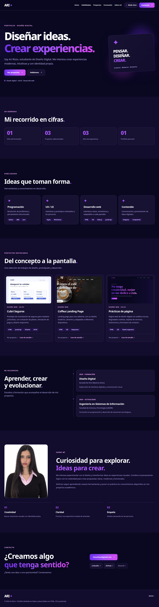
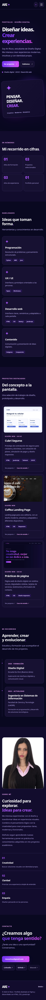

# Portfolio Ari Rizzo

Portfolio personal de diseño digital, UX/UI y desarrollo web. Presenta habilidades, tres proyectos, formación, información personal y contacto mediante una web responsive con modo claro y oscuro.

## Enlaces

- **Portfolio Público:** https://fanciful-torte-a665fb.netlify.app/
- **Diseño en Figma:** https://www.figma.com/design/g2uQPuK6LaBZtNpBC3o17v
- **LinkedIn:** https://www.linkedin.com/in/ariadna-rizzo-6b187544a/
- **GitHub:** https://github.com/rizzoschau-web
- **Contacto:** rizzoschau@gmail.com

## Tecnologías

HTML5 semántico, CSS3 y JavaScript vanilla, sin frameworks ni constructores visuales. Diseño mobile-first con CSS Grid, Flexbox, variables CSS y soporte para `prefers-reduced-motion`. Tipografía Manrope, con carga mediante Google Fonts y `font-display: swap`.

## Secciones y características

Navegación fija, presentación, métricas, habilidades, proyectos, formación, Sobre mí, contacto y pie de página. Cambio de tema persistente, menú móvil accesible y fichas de caso de estudio en modales HTML `<dialog>`.

## Proyectos

- **Cubrí Seguros:** prototipo de contratación digital para celulares y bicicletas, con cotización, validaciones y simulación de pagos.
- **Coffea Landing Page:** landing page para cafetería.
- **Prácticas de página (Ejercicio 20):** página personal de diseño digital desarrollada con HTML y CSS.

## Ejecución

Abrir `index.html` en un navegador o utilizar un servidor local estático, por ejemplo Live Server. No se requieren dependencias ni compilación.

## Capturas del portfolio

**Desktop**

**Mobile**

## Recursos y referencias

- El diseño visual sigue el Figma **Portfolio Ari** y la página de práctica de Ari Rizzo (`TP3_index_20.html` y `TP3_styles_20.css`), de la que se recuperaron los violetas, el magenta y la estética oscura.
- Fotografía personal de Ari suministrada para el portfolio.
- Captura del proyecto Coffea suministrada como referencia del diseño.
- Captura de **Prácticas de página** generada a partir del HTML y CSS originales del ejercicio.
- La imagen de **Cubrí Seguros** es una **ilustración de referencia**, no una captura del prototipo original.
- Tipografía [Manrope](https://fonts.google.com/specimen/Manrope), mediante Google Fonts.
- Diseño realizado en Figma.

## Notas sobre los enlaces

Los botones «Caso de estudio» abren una ficha explicativa de cada proyecto. Los botones «Ver proyecto» y Discord no enlazan a páginas externas porque sus URL no fueron proporcionadas. Cuando estén disponibles, se podrán incorporar sin cambiar el diseño.

Los resultados de tests con personas y las capturas de Lighthouse deben corresponder a mediciones y pruebas reales; no se incluyen resultados inventados.
